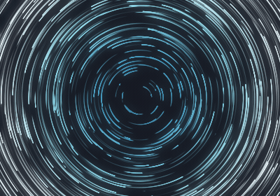
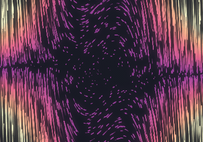
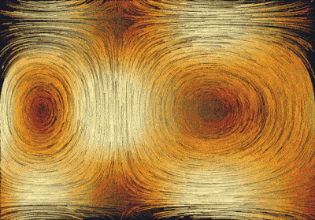

<div align="center">

# Vector Field Studio

**An interactive desktop explorer for 2D vector fields: arrows, streamlines, particles, divergence and curl.**


</div>

Vector Field Studio draws any field **F(x, y, t) = (Fx, Fy)**. Pick one of twelve classic presets or type your
own equations, then switch between arrows, streamlines and animated particles. Colour the background by
speed, divergence or curl, zoom and pan freely, and hover anywhere to read the field's values under the cursor.
When it looks right, export it as a seamless video loop for social media, a GIF, ProRes, PNGs or a still.
It shares its look with [Pixel Sort Studio](https://github.com/omroz14/Pixel-Sort-Studio).

| Arrows | Streamlines | Particles |
|:---:|:---:|:---:|
|  |  |  |

## Demo

| Vortex · Ice | Van der Pol · Magma | Double gyre · Fire |
|:---:|:---:|:---:|
|  |  |  |

## Contents

- [Features](#features)
- [Installation](#installation)
- [Quick start](#quick-start)
- [Writing your own field](#writing-your-own-field)
- [Controls](#controls)
- [Export](#export)
- [Palettes](#palettes)
- [The maths](#the-maths)
- [Tests and benchmarks](#tests-and-benchmarks)
- [Troubleshooting](#troubleshooting)
- [More projects](#more-projects)
- [License](#license)

## Features

- **12 presets:** uniform, source, sink, vortex, saddle, spiral sink, shear, dipole, cellular flow, pendulum,
  the Van der Pol oscillator and the time-dependent double gyre.
- **Your own equations** for Fx and Fy, using `x`, `y`, `t`, `r`, `theta` and the usual maths functions.
- **Three views:** arrows, evenly spaced streamlines (Jobard–Lefer), and animated particles with glowing
  trails that keep an even density on screen while you zoom and pan.
- **Background maps:** speed |F|, divergence or curl, with a colour bar.
- **13 colour palettes** (Studio, Viridis, Magma, Inferno, Plasma, Cividis, Ice, Fire, Turbo, Aurora, Sunset,
  Ocean, Mono) **and your own**, made in the palette editor and kept between sessions.
- **Smooth canvas:** scroll or `+`/`−` to zoom, drag or arrow keys to pan, double-click to centre, rulers with
  the coordinates, a scale bar and exact x / y / zoom entries.
- **Live probe:** shows F, |F|, div F and curl F under the cursor.
- **Time-dependent fields:** fields that use `t` evolve at a time rate you set.
- **Export:** MP4 (H.264), GIF, ProRes 4444, PNG sequences and high-resolution stills in 4:5, 9:16, 1:1 or
  16:9, at 30 or 60 fps, as **seamless loops**. The export looks like the stage, only sharper.

## Installation

You need **Python 3.10 or newer** (developed and tested with 3.12). `pip install -r requirements.txt` also
brings [Numba](https://numba.pydata.org/) for the fast numerical kernels and
[imageio-ffmpeg](https://github.com/imageio/imageio-ffmpeg), which ships its own `ffmpeg`, so there is nothing
else to install for video export.

The very first start compiles the numerical kernels, which takes about ten seconds (the status bar says so).
The result is cached, so later starts are quick.

### Windows

1. Install Python from [python.org](https://www.python.org/downloads/). In the installer, tick
   **Add python.exe to PATH**. Tkinter is included.
2. Download this project: **Code → Download ZIP** on GitHub, then unzip it. If you use Git, run
   `git clone https://github.com/omroz14/Vector-Field-Studio.git` instead.
3. Open PowerShell in the project folder and run:

   ```powershell
   py -m venv .venv
   .venv\Scripts\Activate.ps1
   pip install -r requirements.txt
   py main.py
   ```

   If PowerShell refuses to run `Activate.ps1`, run
   `Set-ExecutionPolicy -Scope CurrentUser RemoteSigned` once, then try again.

### Linux (Debian, Ubuntu, Linux Mint)

Tkinter is a system package, so `pip` cannot install it.

```bash
sudo apt install python3-tk python3-venv git
git clone https://github.com/omroz14/Vector-Field-Studio.git
cd Vector-Field-Studio
python3 -m venv .venv
source .venv/bin/activate
pip install -r requirements.txt
python main.py
```

### macOS

Install Python from [python.org](https://www.python.org/downloads/) (it includes Tkinter), then:

```bash
git clone https://github.com/omroz14/Vector-Field-Studio.git
cd Vector-Field-Studio
python3 -m venv .venv
source .venv/bin/activate
pip install -r requirements.txt
python main.py
```

### Running it again later

Open a terminal in the project folder, activate the environment (`.venv\Scripts\Activate.ps1` on Windows,
`source .venv/bin/activate` elsewhere) and run `python main.py`.

## Quick start

1. Pick a preset, for example **Vortex**.
2. Press `1`, `2` or `3` to switch between arrows, streamlines and particles.
3. Press `B` to cycle the background between speed, divergence and curl, and `P` to change the palette.
4. `Shift`-click anywhere on the canvas to trace the streamline through that point.
5. Try **Double gyre (t)** and press `Space` to watch a time-dependent field evolve.
6. Pick a size in **Export**, line the picture up in the dashed frame, and press **Export video**.

## Writing your own field

Type expressions for **Fx** and **Fy** and press `Enter` to apply them.

| Available | Meaning |
|-----------|---------|
| `x`, `y` | Position |
| `t` | Time (advances while playing) |
| `r`, `theta` | Polar coordinates: `r = √(x² + y²)`, `theta = atan2(y, x)` |
| `pi`, `e` | Constants |
| `sin cos tan asin acos atan atan2` | Trigonometry (`arcsin`-style names work too) |
| `sinh cosh tanh exp log log10 sqrt` | Other functions |
| `abs sign floor min max hypot` | Utilities |

`^` means power, so `x^2` is x². Comparisons give 0 or 1, so `(x > 0)*x` is a piecewise field.
Only these names are allowed, so expressions are evaluated safely.

If `t` only appears inside `sin` or `cos` of `ω·t + c`, the field repeats in time and its period is detected
(for the double gyre, 2π/0.63 ≈ 9.973), so a video loop can be exact. See [Export](#export).

**Examples**

| Field | Fx | Fy |
|-------|----|----|
| Vortex | `-y` | `x` |
| Spiral sink | `-0.3*x - y` | `x - 0.3*y` |
| Pendulum | `y` | `-sin(x)` |
| Rotating wave | `cos(y - t)` | `sin(x + t)` |

## Controls

### Mouse

| Action | Effect |
|--------|--------|
| Scroll | Zoom in / out around the cursor |
| Drag | Pan the view |
| `Ctrl` + drag | Pan with the centre snapping to the grid lines |
| Double-click | Glide that point to the centre |
| `Shift` + click | Trace the streamline through that point |
| Right-click | Clear the traced streamlines |
| Hover | Show F, \|F\|, div F and curl F in the probe |

### Keyboard

| Key | Action |
|-----|--------|
| `Space` | Play / pause |
| `1`–`3` | Arrows / streamlines / particles |
| Arrow keys | Pan by a tenth of the view (`Shift`: by half) |
| `+` / `−` | Zoom in / out around the centre |
| `F` | Zoom out so that what the stage shows fits the export frame |
| `B` | Next background map |
| `P` | Next colour palette |
| `R` | Reset the view |
| `C` | Clear traced streamlines |
| `T` | Reset time |
| `Ctrl+E` | Export video |
| `Ctrl+S` | Save a still (PNG) of the export frame |

Shortcuts are ignored while you are typing in a text field. The **View** card also takes the exact centre
(`x`, `y`) and half height (`±`) of the view: type them and press `Enter`.

### On the stage

The numbers on the rulers are the coordinates of the grid lines. The cross marks the centre, whose
coordinates are in the bottom-right corner, and the bar in the bottom-left corner shows a length in field
units. The dashed rectangle is the **export frame**: what a video or still will show. Everything outside it is
dimmed (only on the stage). Both the frame and the scale bar can be switched off in the **View** card.

## Export

Choose in the **Export** card:

| Setting | Options |
|---------|---------|
| Size | 4:5 (1080 × 1350, the default), 9:16 (1080 × 1920), 1:1 (1080 × 1080), 16:9 (1920 × 1080) |
| Format | **MP4** (H.264), **GIF** (a small preview), **ProRes** 4444 (`.mov`, for editing), **PNGs** (one per frame) |
| Frame rate | 30 or 60 fps |
| Quality | 2× or 3× supersampling of arrows, lines and backgrounds |
| Duration | 1 to 30 seconds (10 by default) |
| Loop | **Seamless loop** (default) or no loop |
| Period of t | The detected period of a time-dependent field; you can type another one |
| Include grid and axes | Off by default: exports show the picture only |

**Export video** (`Ctrl+E`) renders the export frame at the chosen size while the stage keeps running; the
button turns into **Cancel**, and a cancelled export leaves no half-written file. **Save PNG** (`Ctrl+S`)
writes a still of the export frame at the export size. A steady field switches to the particle view first,
since only its particles move.

The export is not a screenshot: it is drawn again at the output size, with line widths, particle sizes,
spacing and speeds scaled to it, so it shows exactly the arrows and streamlines of the stage, just sharper.
Particles keep the density they have on the stage, and their trails are grown before the first frame.

**Seamless loops.** The frame after the last one is the first one:

- In a steady field, the particles follow a schedule that repeats with the loop: each lives a whole fraction
  of it and is reborn at the same place every time round. The trails are made periodic too, so the
  loop is exact to within one level of 255.
- In a field with a period in `t`, the loop covers a whole number of periods (the nearest to what the time
  rate would cover), so it is exact too.
- Any other time-dependent field (or an empty **Period of t** box) is blended: the last frames fade into the
  first ones over about half a second.

MP4 files are H.264 (High profile, CRF 16, yuv420p) with BT.709 colour tags and the index at the front
(`faststart`), ready for upload. GIFs are previews: at most 540 px wide and 25 or 50 fps (GIF counts time in
hundredths of a second), with one palette made from the whole clip.

## Palettes

Pick a palette in the **Colours** card or press `P`. A palette colours the speed (from slow to fast) and,
for div F and curl F, negative and positive values on either side of the stage colour.

**New palette…** opens the editor on a copy of the current palette: give it a name, click a colour to change
it, use `+` and `−` for 2 to 7 colours from slow to fast, and choose the colours below and above zero. The
preview shows both ramps. Your palettes appear after the built-in ones; **Edit…** changes or deletes them.
They are kept in a small JSON file:

| System | File |
|--------|------|
| Windows | `%APPDATA%\VectorFieldStudio\palettes.json` |
| macOS | `~/Library/Application Support/VectorFieldStudio/palettes.json` |
| Linux | `~/.config/vector-field-studio/palettes.json` |

## The maths

For a field F = (Fx, Fy):

- **Speed:** |F| = √(Fx² + Fy²)
- **Divergence:** div F = ∂Fx/∂x + ∂Fy/∂y. Positive values are sources (flow spreads out), negative values are sinks.
- **Curl:** curl F = ∂Fy/∂x − ∂Fx/∂y. Positive values mean counter-clockwise rotation, negative values clockwise.
- **Streamlines** are curves that are tangent to F at every point, which is the path a particle would follow
  in a steady field.

### How it is drawn

F is sampled once on a grid anchored in the world (every 2 points, a little beyond the view) and everything
reads it by bilinear interpolation: streamlines are traced with RK4 and laid out by the Jobard–Lefer
algorithm (a new line starts one spacing beside an existing one and stops when it comes closer than half a
spacing to any line), and particles move by RK4 steps. Particle trails are a density and a speed buffer, so
crowded trails brighten smoothly and take the colour of their mean speed. Rendering runs on a background
thread; the stage keeps a layer a quarter larger than the view, so panning only moves it.

### Project structure

| File | Contents |
|------|----------|
| `main.py` | Entry point. Checks that Tkinter and CustomTkinter are installed. |
| `ui.py` | The window: panels, the stage, navigation, playback and the export settings. |
| `field.py` | Presets, safe expression parsing (and the period in `t`), the view, the sampled grid, streamlines. |
| `kernels.py` | Numba kernels: interpolation, RK4 tracing, Jobard–Lefer layout, particle steps, trail splats, tone map. |
| `particles.py` | Particles and their trails, the density control, and the repeating schedule of seamless loops. |
| `render.py` | The style, heatmaps, guides, arrows and streamlines drawn into images. |
| `viewport.py` | The stage's pixel lattice, the cached layer around the view and the region of 3 × 3 views. |
| `export.py` | The offscreen renderer of the export frame and the ffmpeg writers. |
| `palettes.py`, `palette_editor.py` | The palettes, the user's own ones on disk, and the editor dialog. |
| `worker.py` | The background rendering thread. |
| `theme.py` | Colours, fonts and shared widgets. |
| `tests/` | Tests and a benchmark. |
| `requirements.txt` | Python dependencies (`numpy`, `Pillow`, `customtkinter`, `numba`, `imageio-ffmpeg`). |

## Tests and benchmarks

From the project folder, with the virtual environment active:

```bash
python -m unittest discover tests
```

They check that seamless loops repeat (frame T equals frame 0 within 1/255), that the stage's layer after a
pan matches the one before pixel for pixel, that exports at any size lay out the same streamlines and 30 and
60 fps the same motion, and what exported files contain (codec, pixel format, colour tags, size, frame
rate). They need no display. For timings of the engine:

```bash
python -m tests.benchmark
```

The view images and demo GIFs of this README are made by `python docs/make_images.py`.

## Troubleshooting

| Problem | Fix |
|---------|-----|
| `ModuleNotFoundError: No module named 'tkinter'` | Install Tkinter: `sudo apt install python3-tk` on Linux, or reinstall Python from python.org on Windows/macOS. |
| `CustomTkinter is not installed` | Activate the virtual environment, then run `pip install -r requirements.txt`. |
| `py` or `python` is not recognised (Windows) | Reinstall Python and tick **Add python.exe to PATH**. |
| My equation is rejected | Check that you only use the names listed in [Writing your own field](#writing-your-own-field), and use `*` for multiplication (`2*x`, not `2x`). |
| The first start takes a few seconds | Numba compiles the numerical kernels once and caches them; later starts are quick. |
| `pip` cannot install `numba` | Your Python may be newer than the latest Numba release supports: use a Python version listed on [Numba's installation page](https://numba.readthedocs.io/en/stable/user/installing.html). |
| A loop of a time-dependent field fades at the seam | Its `t` is not periodic, or the **Period of t** box is empty: type the period to make the loop exact. |

## More projects

- [Pixel Sort Studio](https://github.com/omroz14/Pixel-Sort-Studio): sort the pixels of a photo along any direction.
- [Pixel Merger Studio](https://github.com/omroz14/Pixel-Merger-Studio): rebuild one image out of the pixels of another.

## License

Released under the [MIT License](LICENSE). © 2026 Oliwier Mróz.
