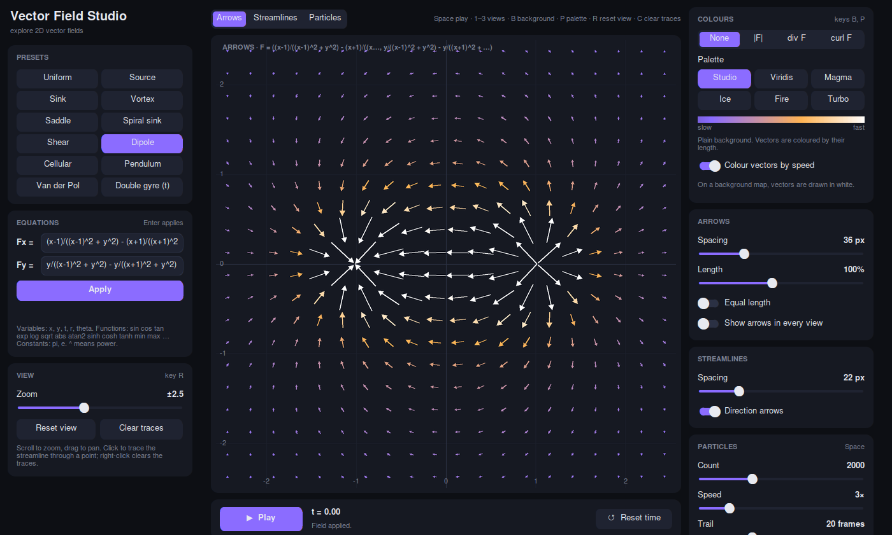
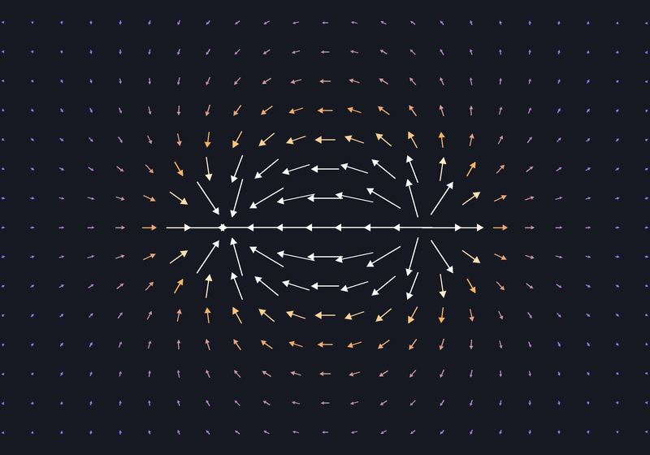
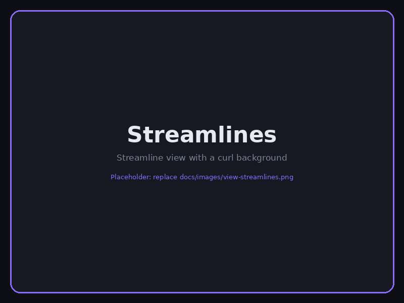
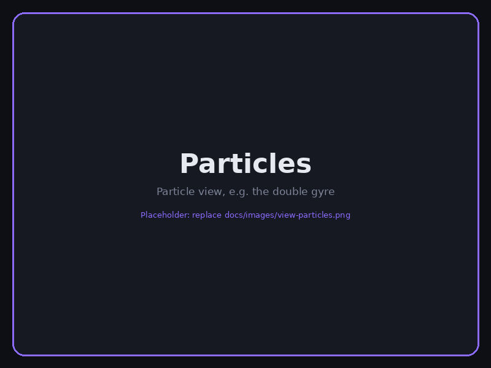

<div align="center">

# Vector Field Studio

**An interactive desktop explorer for 2D vector fields: arrows, streamlines, particles, divergence and curl.**




</div>

Vector Field Studio draws any field **F(x, y, t) = (Fx, Fy)**. Pick one of twelve classic presets or type your
own equations, then switch between arrows, streamlines and animated particles. Colour the background by
speed, divergence or curl, zoom and pan freely, and hover anywhere to read the field's values under the cursor.
It shares its look with [Pixel Sort Studio](https://github.com/omroz14/Pixel-sorter).

| Arrows | Streamlines | Particles |
|:---:|:---:|:---:|
|  |  |  |

## Demo

| Particles | Double gyre | Custom field |
|:---:|:---:|:---:|
|  |  |  |

## Contents

- [Features](#features)
- [Installation](#installation)
- [Quick start](#quick-start)
- [Writing your own field](#writing-your-own-field)
- [Controls](#controls)
- [The maths](#the-maths)
- [Troubleshooting](#troubleshooting)
- [More projects](#more-projects)
- [License](#license)

## Features

- **12 presets:** uniform, source, sink, vortex, saddle, spiral sink, shear, dipole, cellular flow, pendulum,
  the Van der Pol oscillator and the time-dependent double gyre.
- **Your own equations** for Fx and Fy, using `x`, `y`, `t`, `r`, `theta` and the usual maths functions.
- **Three views:** arrows, evenly spaced streamlines, and animated particles with trails.
- **Background maps:** speed |F|, divergence or curl, with a colour bar.
- **Six colour palettes:** Studio, Viridis, Magma, Ice, Fire and Turbo.
- **Interactive canvas:** scroll to zoom, drag to pan, click to trace the streamline through a point.
- **Live probe:** shows F, |F|, div F and curl F under the cursor.
- **Time-dependent fields:** fields that use `t` evolve while the animation plays.
- **Export:** save the view as PNG and the animation as GIF.

## Installation

You need **Python 3.10 or newer** (developed and tested with 3.12).

### Windows

1. Install Python from [python.org](https://www.python.org/downloads/). In the installer, tick
   **Add python.exe to PATH**. Tkinter is included.
2. Download this project: **Code → Download ZIP** on GitHub, then unzip it. If you use Git, run
   `git clone https://github.com/omroz14/VectorFieldVisualizer.git` instead.
3. Open PowerShell in the project folder and run:

   ```powershell
   py -m venv .venv
   .venv\Scripts\Activate.ps1
   pip install -r requirements.txt
   py main.py
   ```

   If PowerShell refuses to run `Activate.ps1`, run
   `Set-ExecutionPolicy -Scope CurrentUser RemoteSigned` once, then try again.

### Linux (Debian, Ubuntu, Linux Mint)

Tkinter is a system package, so `pip` cannot install it.

```bash
sudo apt install python3-tk python3-venv git
git clone https://github.com/omroz14/VectorFieldVisualizer.git
cd VectorFieldVisualizer
python3 -m venv .venv
source .venv/bin/activate
pip install -r requirements.txt
python main.py
```

### macOS

Install Python from [python.org](https://www.python.org/downloads/) (it includes Tkinter), then:

```bash
git clone https://github.com/omroz14/VectorFieldVisualizer.git
cd VectorFieldVisualizer
python3 -m venv .venv
source .venv/bin/activate
pip install -r requirements.txt
python main.py
```

### Running it again later

Open a terminal in the project folder, activate the environment (`.venv\Scripts\Activate.ps1` on Windows,
`source .venv/bin/activate` elsewhere) and run `python main.py`.

## Quick start

1. Pick a preset, for example **Vortex**.
2. Press `1`, `2` or `3` to switch between arrows, streamlines and particles.
3. Press `B` to cycle the background between speed, divergence and curl, and `P` to change the palette.
4. Click anywhere on the canvas to trace the streamline through that point.
5. Try **Double gyre (t)** and press `Space` to watch a time-dependent field evolve.

## Writing your own field

Type expressions for **Fx** and **Fy** and press `Enter` to apply them.

| Available | Meaning |
|-----------|---------|
| `x`, `y` | Position |
| `t` | Time (advances while playing) |
| `r`, `theta` | Polar coordinates: `r = √(x² + y²)`, `theta = atan2(y, x)` |
| `pi`, `e` | Constants |
| `sin cos tan asin acos atan atan2` | Trigonometry (`arcsin`-style names work too) |
| `sinh cosh tanh exp log log10 sqrt` | Other functions |
| `abs sign floor min max hypot` | Utilities |

`^` means power, so `x^2` is x². Comparisons give 0 or 1, so `(x > 0)*x` is a piecewise field.
Only these names are allowed, so expressions are evaluated safely.

**Examples**

| Field | Fx | Fy |
|-------|----|----|
| Vortex | `-y` | `x` |
| Spiral sink | `-0.3*x - y` | `x - 0.3*y` |
| Pendulum | `y` | `-sin(x)` |
| Rotating wave | `cos(y - t)` | `sin(x + t)` |

## Controls

### Mouse

| Action | Effect |
|--------|--------|
| Scroll | Zoom in / out around the cursor |
| Drag | Pan the view |
| Click | Trace the streamline through that point |
| Right-click | Clear the traced streamlines |
| Hover | Show F, \|F\|, div F and curl F in the probe |

### Keyboard

| Key | Action |
|-----|--------|
| `Space` | Play / pause |
| `1`–`3` | Arrows / streamlines / particles |
| `B` | Next background map |
| `P` | Next colour palette |
| `R` | Reset the view |
| `C` | Clear traced streamlines |
| `T` | Reset time |
| `Ctrl+S` | Save the view as PNG |

Shortcuts are ignored while you are typing in an equation field.

## The maths

For a field F = (Fx, Fy):

- **Speed:** |F| = √(Fx² + Fy²)
- **Divergence:** div F = ∂Fx/∂x + ∂Fy/∂y. Positive values are sources (flow spreads out), negative values are sinks.
- **Curl:** curl F = ∂Fy/∂x − ∂Fx/∂y. Positive values mean counter-clockwise rotation, negative values clockwise.
- **Streamlines** are curves that are tangent to F at every point, which is the path a particle would follow
  in a steady field.

### Project structure

| File | Contents |
|------|----------|
| `main.py` | Entry point. Checks that Tkinter and CustomTkinter are installed. |
| `ui.py` | The window: panels, canvas interaction, playback and export. |
| `field.py` | Presets, safe expression parsing, the view transform, streamline tracing and particles. |
| `render.py` | Drawing arrows, streamlines, particles, background maps and colour palettes. |
| `theme.py` | Colours, fonts and shared widgets. |
| `requirements.txt` | Python dependencies (`numpy`, `Pillow`, `customtkinter`). |

## Troubleshooting

| Problem | Fix |
|---------|-----|
| `ModuleNotFoundError: No module named 'tkinter'` | Install Tkinter: `sudo apt install python3-tk` on Linux, or reinstall Python from python.org on Windows/macOS. |
| `CustomTkinter is not installed` | Activate the virtual environment, then run `pip install -r requirements.txt`. |
| `py` or `python` is not recognised (Windows) | Reinstall Python and tick **Add python.exe to PATH**. |
| My equation is rejected | Check that you only use the names listed in [Writing your own field](#writing-your-own-field), and use `*` for multiplication (`2*x`, not `2x`). |

## More projects

- [Pixel Sort Studio](https://github.com/omroz14/Pixel-sorter): sort the pixels of a photo along any direction.
- [Pixel Merger](https://github.com/omroz14/Pixel-Merger): rebuild one image out of the pixels of another.

## License

Released under the [MIT License](LICENSE). © 2026 Oliwier Mróz.
